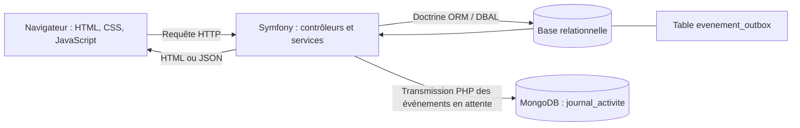

# Incipit — Ma bibliothèque à portée de main

Incipit est une application web de gestion de bibliothèque personnelle. Elle permet de retrouver les livres possédés, de suivre les lectures, de préparer les prochains achats et de gérer les prêts depuis un ordinateur ou un téléphone.

J’ai conçu ce projet dans le cadre de ma formation **Graduate Développement Web Full Stack**. Son origine est personnelle : lors de mes visites en librairie, il m’arrivait de ne plus savoir si je possédais déjà un ouvrage et de l’acheter une seconde fois. Incipit rassemble les informations de ma bibliothèque dans un espace consultable à distance.

Une partie publique permet à mes proches de consulter mes sélections et les livres que je souhaite recevoir. La gestion de la bibliothèque reste privée.

**Application en ligne : [https://incipit.alwaysdata.net/](https://incipit.alwaysdata.net/)**  
**Dépôt du code : [github.com/manonlrt261/Incipit](https://github.com/manonlrt261/Incipit)**  
**Autrice : Manon FAYOLLE**  
**Documentation révisée le 27 octobre 2026.**

## Sommaire

1. [Fonctionnalités](#1-fonctionnalités)
2. [Technologies et architecture](#2-technologies-et-architecture)
3. [Organisation du dépôt](#3-organisation-du-dépôt)
4. [Prérequis](#4-prérequis)
5. [Installation locale](#5-installation-locale)
6. [Tests et validation](#6-tests-et-validation)
7. [Déploiement sur Alwaysdata](#7-déploiement-sur-alwaysdata)
8. [Journal et exploitation](#8-journal-et-exploitation)
9. [Sauvegardes et restauration](#9-sauvegardes-et-restauration)
10. [Sécurité et confidentialité](#10-sécurité-et-confidentialité)
11. [Limites et évolutions](#11-limites-et-évolutions)
12. [Autrice](#12-autrice)

## 1. Fonctionnalités

| Domaine | Fonctionnalités présentes |
| --- | --- |
| Livres | Ajout et modification des informations bibliographiques : titre, auteurs, genres, ISBN, édition, saga, tome, résumé et couverture. |
| Collection | Consultation des ouvrages possédés, retrait sans effacement des lectures et retour d’un ouvrage retiré dans la collection. |
| Recherche | Recherche textuelle, filtres combinables et tris selon les pages. |
| Lectures | Sessions successives, statuts, dates, notes sur cinq par demi-étoile et avis. |
| Pile à lire | Sélection de livres possédés, démarrage d’une lecture et retrait automatique de la pile lorsqu’une lecture est terminée. |
| Wishlist | Ajout, modification, suppression, priorité, visibilité publique et passage d’un souhait acheté vers la collection. |
| Auteurs | Recherche, tri par nom ou prénom, consultation des livres associés et regroupement par saga à partir des informations enregistrées. |
| Prêts et contacts | Ajout et suppression de prêts, gestion des contacts et consultation des prêts d’un contact. |
| Tableau de bord et statistiques | Indicateurs, lectures par mois, comparaison annuelle, genres, auteurs les plus lus et objectif annuel. |
| Accueil public | Visibilité et ordre des sélections configurables depuis l’espace autorisé. |
| Compte | Connexion, déconnexion, profil, changement du mot de passe et réinitialisation par courriel. |
| Journal d’activité | Consultation filtrée des événements pris en charge, avec conservation préalable dans une file SQL. |
| Informations | Pages Aide et contact, CGU, Mentions légales et Données personnelles. |

### Quelques règles métier

- Un **livre** décrit les informations bibliographiques ; un **exemplaire** représente sa présence physique dans la collection ; une **session de lecture** conserve un suivi de lecture.
- L’avertissement de doublon compare le titre normalisé et au moins un auteur commun parmi les livres encore possédés. L’utilisatrice peut confirmer volontairement l’ajout d’une autre fiche ; il ne s’agit pas d’une unicité imposée par l’ISBN.
- Une date de fin antérieure à la date de début est refusée. Une note absente reste distincte de zéro. Le statut « Abandonné » impose une note de zéro.
- Un souhait acheté réutilise la fiche du livre, crée un exemplaire et une session « Pas commencé », puis quitte les souhaits actifs et publics.
- Retirer un ouvrage de la collection conserve sa fiche et son historique. Cette action n’est pas une suppression définitive des données.
- Les statistiques mensuelles et annuelles comptent les sessions terminées datées ; les graphiques par genre utilisent, selon leur périmètre, des livres distincts. Les relectures ne sont donc pas comptées de la même façon dans tous les indicateurs.

### Services complémentaires

Les métadonnées ISBN sont recherchées auprès d’Open Library, de Google Books lorsque sa clé est configurée, et de la BnF. La recherche de couvertures utilise SerpAPI. La saisie manuelle reste disponible lorsque les catalogues ne répondent pas ou proposent des données incomplètes.

L’import de couverture et le scan avec `html5-qrcode` dépendent du navigateur, du matériel et des permissions. Les courriels utilisent Symfony Mailer ; la configuration d’hébergement documentée emploie Brevo.

## 2. Technologies et architecture

| Couche | Technologies et rôle |
| --- | --- |
| Serveur | PHP et Symfony 7.4 : routes, contrôleurs, formulaires, sécurité et services métier. |
| Accès relationnel | Doctrine ORM pour les entités ; Doctrine DBAL pour les requêtes explicites. |
| Pages | Twig pour générer le HTML ; CSS pour la présentation et l’adaptation aux écrans. |
| Interactions | JavaScript, Symfony AssetMapper, Importmap, Stimulus et Turbo. |
| Données métier | Base relationnelle MySQL/MariaDB, avec une procédure de reconstruction par migrations vérifiée sur MySQL. |
| Journal | Pilote PHP MongoDB et collection `journal_activite`, hébergée sur Atlas dans la configuration publiée. |
| Outils | Figma, Visual Studio Code, Git et GitHub. |
| Hébergement | Alwaysdata, avec racine web limitée à `public/`. |

Une part importante des interactions est écrite dans les modules JavaScript du projet ; elles ne reposent pas toutes sur des contrôleurs Stimulus. L’interface n’utilise pas de chaîne de compilation npm pour son fonctionnement courant.



Le navigateur n’accède pas directement aux bases. Pour les opérations couvertes, l’événement est conservé dans la transaction SQL du traitement métier, puis transmis à MongoDB. Une indisponibilité temporaire de MongoDB diffère la transmission sans annuler l’opération métier déjà validée.

## 3. Organisation du dépôt

```text
incipit/
├── README.md                 Présentation générale et orientation
├── assets/                   JavaScript, CSS, images et ressources
├── config/                   Configuration Symfony et des bundles
├── docs/                     Documentation fonctionnelle et technique
├── migrations/               Migrations du schéma relationnel
├── public/                   Racine accessible au navigateur
├── scripts/                  Scripts d’exploitation et de sauvegarde
├── src/
│   ├── Command/              Commandes administrateur et journal
│   ├── Controller/           Routes et traitements des requêtes
│   ├── Entity/               Modèle relationnel Doctrine
│   ├── EventListener/        Journalisation et transmission différée
│   ├── Form/                 Formulaires Symfony
│   ├── Repository/           Accès aux entités
│   └── Service/              Règles métier et intégrations
├── templates/                Vues et composants Twig
├── tests/                    Scripts de vérification
├── composer.json             Dépendances et commandes Composer
├── composer.lock             Versions exactes des dépendances
└── importmap.php              Dépendances JavaScript gérées par Importmap
```

Les dépendances installées, les fichiers temporaires, les sauvegardes et la configuration privée ne sont pas des livrables à publier dans le dépôt.

## 4. Prérequis

| Élément | Exigence |
| --- | --- |
| PHP | Avec le verrouillage actuel, prévoir PHP **8.4.1 minimum** pour les dépendances de développement. La contrainte directe `>=8.2` de `composer.json` ne suffit pas : `doctrine/collections` exige PHP 8.4 et PHPUnit 13.4.2 exige PHP 8.4.1. |
| Composer | Installation des versions de `composer.lock` et contrôle des extensions avec `composer check-platform-reqs`. |
| Git | Récupération du dépôt et suivi des versions. |
| Base relationnelle | Serveur MySQL pour la procédure de reconstruction de référence, vérifiée sur MySQL 8.4.11. |
| Extensions PHP | Exigences Composer, `pdo_mysql` pour les données métier et `mongodb` pour le journal. Le test du journal demande aussi `pdo_sqlite`. |
| Symfony CLI | Nécessaire pour `symfony server:start` ; un serveur PHP de développement constitue une alternative. |
| Node.js | Nécessaire au test des filtres JavaScript, pas à une compilation npm de l’interface. |
| MongoDB | Instance locale ou environnement Atlas dédié ; les tests demandent leurs instances locales spécifiques. |
| Sauvegarde | `mysqldump`, `tar`, accès SQL/MongoDB et destination privée accessible en écriture. |

## 5. Installation locale

### 5.1 Récupérer les fichiers et vérifier la migration initiale

```bash
git clone https://github.com/manonlrt261/Incipit.git incipit
cd incipit
git rev-parse HEAD
```

Vérifier sa présence dans la copie récupérée :

```bash
test -f migrations/Version20261014000000.php
```

Si le fichier manque, arrêter la préparation de la base et obtenir la version complète. Ne pas remplacer la migration manquante par un import improvisé du script documentaire.

Installer les dépendances sans déclencher immédiatement les scripts applicatifs :

```bash
composer install --no-scripts
composer check-platform-reqs
```

### 5.2 Préparer la configuration privée

Le projet ne fournit pas actuellement de `.env.example`. Créer un fichier `.env.local` à sa racine ; il doit rester ignoré par Git. Les valeurs réelles sont renseignées uniquement sur l’installation concernée.

| Variable | Valeur ou action |
| --- | --- |
| `APP_ENV` | `dev` pour l’installation locale. |
| `APP_DEBUG` | `1` en développement ; `0` en production. |
| `APP_SECRET` | Secret aléatoire propre à chaque installation, généré avec la commande PHP ci-dessous et enregistré uniquement dans `.env.local`. |
| `DATABASE_URL` | URL de connexion à la base locale dédiée : compte, mot de passe, serveur, port et nom de base. Préciser la version réelle avec `serverVersion` et utiliser `charset=utf8mb4`. Encoder les caractères réservés des identifiants. |
| `DEFAULT_URI` | `http://127.0.0.1:8000` si le serveur local écoute à cette adresse ; adapter le protocole et le port à ceux annoncés au démarrage. |
| `MESSENGER_TRANSPORT_DSN` | `doctrine://default?auto_setup=0` dans la configuration locale de référence. |
| `MAILER_DSN` | `null://null` pour désactiver les envois pendant le développement. Pour tester la réinitialisation, utiliser un transport SMTP autorisé réservé aux essais. |
| `MAILER_FROM` | Adresse d’expédition autorisée par le fournisseur SMTP. Sans envoi réel, une adresse fictive telle que `incipit@example.com` convient à la configuration locale. |
| `MONGODB_URI` | Chaîne vide si le journal n’est pas activé ; `mongodb://127.0.0.1:27017` pour une instance locale disponible sur ce port. Une connexion Atlas de développement reste privée. |
| `MONGODB_DB` | `incipit_journal_local` pour l’exemple de développement, distinct de la base du journal publié. |
| `GOOGLE_BOOKS_API_KEY` | Clé facultative conservée côté serveur. Si elle est absente, cette source est ignorée et les autres catalogues ISBN restent disponibles. |
| `SERPAPI_API_KEY` | Clé du service de recherche de couvertures, conservée côté serveur ; laisser vide si ce service n’est pas utilisé. |

Les paramètres ci-dessus sont propres à l’installation locale. Les valeurs d’exemple ne sont pas les identifiants du site publié et aucun secret ne doit être ajouté au README.

Un secret peut être généré localement avec :

```bash
php -r 'echo bin2hex(random_bytes(32)), PHP_EOL;'
```

Protéger ensuite le fichier et contrôler son exclusion de Git :

```bash
chmod 600 .env.local
git check-ignore .env.local
```

Avec le transport de courriel nul, aucun message n’est délivré. Le journal reste indisponible tant que son extension et sa connexion ne sont pas configurées ; les événements couverts peuvent rester en attente dans SQL.

### 5.3 Préparer la base vide et le compte

Après vérification de la cible et disponibilité de toutes les migrations :

```bash
php bin/console doctrine:database:create
php bin/console doctrine:migrations:migrate --no-interaction
php bin/console doctrine:schema:validate
php bin/console doctrine:migrations:status
php bin/console app:create-admin
```

Si le compte SQL ne peut pas créer la base, la faire créer vide avant de poursuivre. La procédure de reconstruction de référence utilise une migration initiale suivie de huit évolutions et prépare 18 genres, dont « Sans genre », sans importer les données personnelles.

La commande administrateur demande une adresse e-mail, un mot de passe et sa confirmation masquée. Elle contrôle une longueur minimale de douze octets avec `strlen`, puis enregistre le hachage du mot de passe.

Ne pas cumuler l’import de `docs/base-de-donnees/scripts-sql/creation.sql` avec cette reconstruction par migrations. Le script documentaire utilise des collations MariaDB et son import n’enregistre pas les migrations comme exécutées.

### 5.4 Installer les ressources et démarrer

```bash
php bin/console importmap:install
php bin/console assets:install public
php bin/console cache:clear
symfony server:start
```

Utiliser l’adresse annoncée par le serveur et adapter `DEFAULT_URI`. Sans Symfony CLI, pour le développement uniquement :

```bash
php -S 127.0.0.1:8000 -t public
```

Vérifier l’accueil, la connexion, l’ajout manuel d’un livre, sa fiche après rechargement et les pages principales. Le téléphone utilise sa propre adresse `127.0.0.1` : un essai caméra depuis cet appareil nécessite une adresse accessible et un contexte sécurisé adapté.

### 5.5 Limite de la configuration Docker

Les fichiers `compose.yaml` et `compose.override.yaml` hérités du socle proposent PostgreSQL et Mailpit. Ils ne constituent pas une installation complète vérifiée d’Incipit, dont les requêtes et migrations utilisent MySQL/MariaDB. La procédure ci-dessus ne demande pas de lancer Docker.

## 6. Tests et validation

### Campagne automatisée de référence

La campagne locale du **20 octobre 2026** comporte huit suites réussies, avec un code de sortie final `0`. Le compte rendu conserve les jeux d’essai, les observations et la sortie du lanceur.

| Suite | Résultat de la campagne du 20 octobre |
| --- | --- |
| Règles de lecture et saisies invalides | Succès — 7 contrôles métier. |
| Filtres combinables | Succès. |
| Accès privés | Succès — 171 contrôles. |
| Confidentialité visiteurs | Succès — 64 contrôles. |
| Recherche du tableau de bord | Succès. |
| Restauration de la collection | Succès. |
| Journal et panne MongoDB | Succès — 30 contrôles. |
| Archive MongoDB | Succès — 10 contrôles. |

Ces résultats ne sont pas une nouvelle validation du site publié. Une vérification ultérieure du journal est restée non exécutée faute d’instance de test disponible ; ce statut est conservé dans le rapport.

### Préparer une nouvelle exécution

Les tests sont des scripts dédiés ; la présence de PHPUnit dans les dépendances ne signifie pas que tous les contrôles sont des tests PHPUnit. Certains scripts écrivent des données temporaires, annulent des transactions ou créent et suppriment des bases temporaires.

Sur l’environnement local préparé, les six suites hors MongoDB se lancent avec :

```bash
bash tests/executer.sh --local
```

Pour inclure les deux suites MongoDB :

```bash
bash tests/executer.sh --local --mongodb
```

Le journal demande une instance locale sur `127.0.0.1:28719`, et l’archive une instance locale sur `127.0.0.1:27017`. Le port `28720` doit rester sans service pour simuler l’indisponibilité. Le test du journal utilise aussi SQLite. Consigner séparément chaque nouvelle date, version, sortie et code de retour.

### Vérifications manuelles

Après les mises à jour du site déployé, j’ai contrôlé manuellement les principaux parcours, boutons, formulaires et comportements visibles. Ces essais complètent les contrôles automatisés en vérifiant l’utilisation de l’application dans le navigateur.

La recette est organisée autour de **54 scénarios**. Ils couvrent les domaines suivants :

| Domaine | Points de contrôle prévus dans la recette |
| --- | --- |
| Accès et compte | Connexion, refus d’un mot de passe incorrect, visibilité du mot de passe, déconnexion et accès direct aux pages privées. |
| Réinitialisation | Réception du courriel, utilisation du lien, expiration, non-réutilisation et refus d’un nouveau mot de passe invalide. |
| Livres et collection | Ajout, modification, associations d’auteurs et genres, avertissement de doublon, retrait et retour dans la collection. |
| Lectures | Ajout, modification et suppression d’une session ; notes, dates, relecture et conservation de l’historique. |
| Pile à lire | Ajout et retrait de la sélection, démarrage d’une lecture et sortie de pile après une lecture terminée. |
| Wishlist et public | Création, modification, achat et suppression d’un souhait ; visibilité publique et protection des détails privés. |
| Prêts et contacts | Gestion des contacts, ajout et suppression d’un prêt, consultation par contact et combinaison des filtres. |
| Statistiques | Cohérence des indicateurs avec les lectures, périodes sélectionnées et objectif annuel. |
| Recherche et interface | Recherche ISBN et couvertures, caméra, tris, filtres combinés, affichage mobile, logos et séparateurs alphabétiques. |
| Journal | Filtres, pagination, validation des périodes et correspondance entre les événements SQL et MongoDB. |

Les observations manuelles consignées comprennent le refus d’une connexion avec un mot de passe incorrect, l’affichage de l’alerte lorsqu’un livre est déjà présent, le tri par prénom plaçant Antoine de Saint-Exupéry avant Marceau Miller après correction et la disparition du zoom automatique gênant lors de la recherche sur iPhone.

Les contrôles visuels ont notamment utilisé le mode de conception adaptative de Safari et des essais sur iPhone. Les retours de proches ont conduit à ajuster l’accroche, le logo de connexion, l’alignement des logos sur téléphone, l’accès aux détails de la wishlist publique et l’ordre de navigation.

Pour les opérations d’enregistrement, le contrôle de persistance consiste à recharger la page puis à retrouver les informations. Pour un cas de refus, l’attendu est un message compréhensible et la conservation des données valides précédentes. Chaque résultat de recette doit être rattaché à sa version, à son navigateur et aux manipulations réalisées.

Les 54 scénarios définissent le périmètre de recette ; ils ne correspondent pas à 54 résultats manuels individuellement attestés. Aucun audit complet d’accessibilité, aucune mesure globale de performance ni restauration complète de production n’est établi par ces essais.

## 7. Déploiement sur Alwaysdata

La dernière méthode documentée est une publication **manuelle par archive** dans une installation existante. Les dépendances et la configuration privée étaient déjà présentes. GitHub conserve les versions ; un envoi de commit ne publie pas automatiquement le site.

| Élément | Configuration documentée |
| --- | --- |
| Adresse | `https://incipit.alwaysdata.net/` |
| Répertoire applicatif | `/home/incipit/www/incipit` |
| Racine web | `/home/incipit/www/incipit/public/` |
| PHP de l’hébergement | Branche 8.4. |
| Journal | MongoDB Atlas, via le pilote PHP. |
| Publication automatisée | Aucune chaîne de déploiement automatique activée. |

La publication suit les étapes suivantes :

1. Sélectionner les fichiers de la version à publier et les regrouper dans une archive.
2. Sauvegarder l’installation existante et conserver les exports de données nécessaires.
3. Transférer l’archive sur Alwaysdata, puis se placer dans `/home/incipit/www/incipit`.
4. Extraire les fichiers dans le répertoire applicatif et retirer les fichiers devenus inutiles uniquement s’ils ont été identifiés.
5. Renouveler le cache et compiler les ressources en production.
6. Ouvrir le site et contrôler les parcours concernés par la mise à jour.

Le paquet de mise à jour ne contient pas une installation autonome. La configuration privée reste sur le serveur ; elle n’est pas remplacée par celle de l’ordinateur. Une évolution des dépendances ou du schéma nécessite un traitement distinct adapté à la version publiée.

Après extraction du paquet, les commandes utilisées pour la publication finale étaient :

```bash
APP_ENV=prod APP_DEBUG=0 php bin/console cache:clear
APP_ENV=prod APP_DEBUG=0 php bin/console asset-map:compile
```

Le lancement documenté a compilé **115 ressources** et écrit les fichiers de correspondance AssetMapper. Ce nombre appartient à cette version et peut varier lors d’une publication ultérieure.

Après publication, vérifier les parcours dans le navigateur, le chargement des ressources, les accès publics et privés et les messages d’erreur. Le succès d’une commande ne suffit pas à valider toute l’interface.

## 8. Journal et exploitation

Les opérations prises en charge sont conservées dans `evenement_outbox`, puis transmises à `journal_activite`. L’écriture MongoDB utilise un identifiant stable, `upsert` et `$setOnInsert` pour éviter une seconde insertion du même événement lors d’une reprise.

Le journal couvre notamment les livres, lectures, souhaits et prêts instrumentés par l’écouteur Doctrine. Une modification SQL directe ou une opération sans compte administrateur reconnu ne produit pas nécessairement d’événement.

La reprise manuelle utilise :

```bash
APP_ENV=prod APP_DEBUG=0 php bin/console app:journal:transmettre
```

Cette commande écrit dans MongoDB et met à jour SQL ; ce n’est pas une consultation. Elle traite au maximum 100 événements par exécution. La tentative après une réponse HTTP réussie traite, elle, un lot maximal de 20.

Une tâche de reprise est configurée toutes les **cinq minutes** dans l’exploitation documentée. Un résultat nul peut correspondre à une file vide, sans tentative de connexion à MongoDB.

La page du journal propose des filtres par action, titre et période, ainsi qu’une pagination de 30 événements. Son compteur d’attente provient de SQL et reste indépendant des filtres MongoDB. Consulter la page ne déclenche pas une transmission.

Pour suivre la file sans modifier les données :

```sql
SELECT statut, COUNT(*) AS nombre_evenements,
       MIN(date_creation) AS plus_ancien_evenement
FROM evenement_outbox
GROUP BY statut
ORDER BY statut;
```

Si la file augmente durablement, comparer les accès SQL/MongoDB, les configurations PHP du serveur web, du terminal et des tâches, puis consulter les diagnostics privés. Le fichier `var/log/journal-mongodb.log` concerne les erreurs de consultation ; les échecs de transmission produisent l’avertissement `Transmission du journal différée.` dans les journaux de l’application.

Une reprise conserve l’identifiant de chaque événement. Ne pas vider la file ni marquer arbitrairement les lignes comme transmises pour masquer une erreur : corriger la cause, puis reprendre par la commande prévue.

## 9. Sauvegardes et restauration

Le script `scripts/sauvegarder-incipit.php` exporte la base SQL, archive les couvertures importées et sauvegarde les documents MongoDB et leurs index. Il produit des empreintes SHA-256 et signale les exports incomplets.

Exemple pour l’installation Alwaysdata documentée, après vérification de la source et de la destination :

```bash
APP_ENV=prod APP_DEBUG=0 php scripts/sauvegarder-incipit.php /home/incipit/www/incipit /home/incipit/sauvegardes
```

La destination doit rester privée, hors de `public/`. Les images hébergées à distance ne sont pas téléchargées par ce script. Les exports successifs ne forment pas un instantané atomique commun à SQL, MongoDB et aux fichiers.

Pour vérifier les empreintes, se placer dans le dossier exact de la sauvegarde puis utiliser, selon le système :

```bash
sha256sum -c SHA256SUMS
```

Ou sur macOS :

```bash
shasum -a 256 -c SHA256SUMS
```

Une sauvegarde manuelle SQL, couvertures et MongoDB a réussi sur Alwaysdata le **20 octobre 2026**. La campagne locale de la même date comprend une restauration MongoDB isolée avec contrôle des types BSON et des index. Une tâche quotidienne à **03:00** est configurée pour les sauvegardes ; sa réussite récurrente doit être suivie dans les comptes rendus d’exécution de l’hébergement, en tenant compte du fuseau de planification.

### Contenu des sauvegardes

Le dossier produit contient notamment :

- `base.sql` : structure et données relationnelles, y compris l’outbox et l’historique de migrations ;
- `couvertures.tar.gz` : fichiers importés, lorsque le dossier des couvertures existe ;
- `journal.mongodb.jsonl.gz` : événements en Extended JSON canonique compressé ;
- `journal.mongodb.metadata.json` : nombre de documents, types de format, index et empreinte du contenu ;
- `SHA256SUMS` : empreintes des fichiers sauvegardés ;
- `ECHEC.txt` : signalement d’un export incomplet lorsqu’un échec est intercepté.

Une empreinte valide confirme la correspondance des fichiers avec le manifeste ; elle ne valide pas la restauration de toute l’application. Le fichier MongoDB n’est pas une archive `mongodump` et ne doit pas être passé à `mongorestore --archive`.

### Conservation et récupération

Le script conserve les sauvegardes dans des dossiers distincts et ne supprime pas automatiquement les anciennes copies. Aucune politique de rotation ni copie hors serveur opérationnelle n’est établie dans les résultats disponibles. La conservation doit tenir compte de l’espace utilisé et de la confidentialité des exports ; une copie uniquement sur le serveur ne couvre pas la perte de ce serveur.

Une restauration complète se prépare dans un environnement isolé :

1. Vérifier les empreintes et identifier la version du code correspondant à la sauvegarde.
2. Préparer des bases SQL et MongoDB et un répertoire de couvertures distincts de la production.
3. Examiner le dump SQL, notamment ses instructions de création et de sélection de base, avant import.
4. Restaurer les couvertures dans la copie d’essai et contrôler leur correspondance avec les fiches.
5. Décoder les documents du journal avec le mécanisme BSON adapté, conserver leurs identifiants et recréer les index applicatifs.
6. Contrôler les données métier, les accès, les historiques et la cohérence de l’outbox avant toute remise en service.

L’essai MongoDB isolé ne constitue pas une restauration globale du site publié. Cette validation complète reste à réaliser ; les exports successifs peuvent également nécessiter un examen des écarts entre la file SQL et les documents MongoDB.

## 10. Sécurité et confidentialité

Les mécanismes présents comprennent :

- authentification par e-mail et mot de passe haché avec Symfony Security ;
- autorisations serveur pour les parcours privés ;
- jetons CSRF sur la connexion, la déconnexion et les actions concernées ;
- validation des saisies et centralisation des règles de lecture ;
- paramètres liés dans les requêtes SQL et construction serveur des filtres MongoDB ;
- échappement Twig et utilisation de `textContent` aux emplacements concernés ;
- contrôle des couvertures importées : JPEG, PNG, WebP ou GIF, taille maximale de 5 Mio et nom aléatoire ;
- sélection des données publiques et conservation des secrets côté serveur.

Le lien de réinitialisation du mot de passe est configuré pour **900 secondes**, soit quinze minutes. La réinitialisation, le changement depuis le profil et la création en ligne de commande n’appliquent pas exactement les mêmes contraintes de mot de passe.

Les fichiers `.env.local`, les sauvegardes, exports de données, cookies, jetons et identifiants de démonstration ne doivent pas être publiés. Les couvertures stockées sous `public/uploads/couvertures` sont publiques ; le journal contient au contraire des informations privées d’activité et de compte.

Avant publication, contrôler les données sensibles de l’historique Git et des archives. L’ajout d’un fichier à `.gitignore` n’affecte pas un fichier déjà suivi et n’efface pas un secret présent dans les anciens commits. Si un secret a été exposé, son retrait du fichier courant doit être accompagné de sa révocation ou de son remplacement.

Les droits sont vérifiés côté serveur : masquer un bouton ne suffit pas à protéger une action. Un rôle autorisé, une méthode HTTP adaptée et un jeton CSRF répondent à des contrôles différents. Les saisies de lecture sont validées par `DonneesLecture`, les images par `CouvertureLivre` et les sélections publiques par les règles de visibilité.

Les détails privés du journal restent réservés aux administrateurs. Les erreurs présentées au navigateur ne doivent pas révéler les identifiants des bases ou les paramètres SMTP. Les permissions serveur, les cookies de session et les en-têtes HTTP de production demandent des contrôles propres à l’hébergement ; leur présence ne se déduit pas des seuls fichiers locaux.

## 11. Limites et évolutions

### Limites connues

- Bibliothèque commune aux comptes autorisés, sans isolation par propriétaire ni inscription publique.
- Détection des doublons par titre et auteur, sans déduplication universelle des éditions.
- Disponibilité des métadonnées, couvertures et courriels dépendante des services externes.
- Transmission du journal différée en cas d’indisponibilité ; absence de transaction distribuée entre les deux bases.
- Configuration Docker héritée non harmonisée avec la procédure MySQL.
- Audit complet d’accessibilité et mesures globales de performance non réalisés.
- Suivi récurrent des sauvegardes, copie hors serveur et restauration globale encore à valider.

### Évolution envisagée

Je souhaite étudier un outil de recommandation fondé sur mes lectures et mes appréciations. L’objectif serait de demander des ouvrages proches d’un livre apprécié, par exemple *Oscar et la dame en rose*. Cette fonctionnalité n’est pas développée ; le fournisseur, les données transmises et les critères de qualité restent à définir avant toute mise en œuvre.

## 12. Autrice

**Manon FAYOLLE** — projet personnel réalisé dans le cadre de la formation Graduate Développement Web Full Stack.
